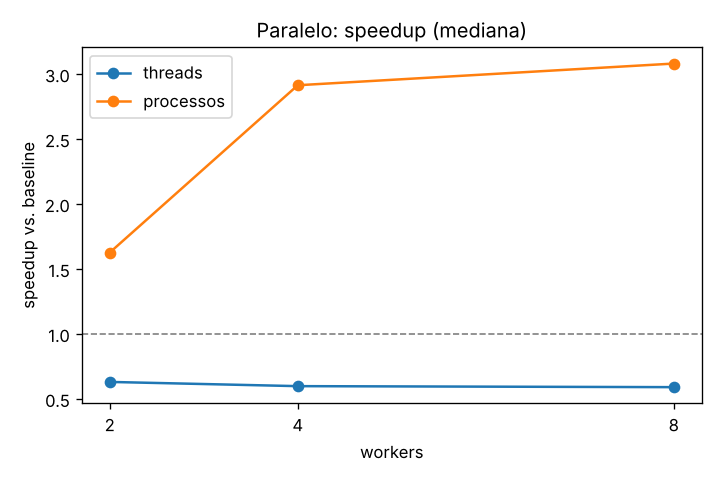
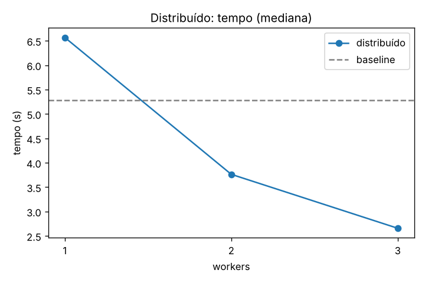

# SalesFlow

Cálculo da **receita por categoria e por marca** a partir de eventos de e-commerce, em três versões: baseline sequencial, paralela (threads vs. processos) e distribuída (coordenador + workers HTTP com tolerância a falha). Projeto da disciplina *Fundamentos da Programação Paralela e Distribuída*.

Apresentação do projeto: [`docs/SalesFlow.pptx`](docs/SalesFlow.pptx).

## 1. Dados

- Origem desta execução: **dados sintéticos** gerados por `scripts/generate_synthetic.py` (semente fixa 42; sem credenciais do Kaggle neste ambiente).
- Recorte: 5,000,000 linhas (552 MB), conforme `data/SOURCE.txt`. O esquema é o da base *E-commerce behavior data from multi-category store* (`event_time, event_type, product_id, category_id, category_code, brand, price, user_id, user_session`).
- Regras de limpeza (função única `process_row` em `common.py`):
  - só `event_type == "purchase"` é considerado; as demais linhas vão para o contador `ignored`;
  - compra com `price` vazio, não numérico, não finito ou <= 0 vai para `invalid`;
  - categoria ou marca vazia vira `"desconhecido"`;
  - dinheiro em **centavos inteiros** (via `Decimal`, arredondamento half-up), então somas são exatas e as versões são comparadas com `==`.
- Resultado do baseline: 191,052 compras válidas, 9,105 inválidas, 4,799,843 ignoradas.

## 2. Arquitetura

```
PARALELO (uma máquina)                       DISTRIBUÍDO (rede)
 split_blocks -> [(id,start,end)...]          coordinator.py  -- fila de blocos --+
        |                                          |  (um fio por worker)          |
   Thread/ProcessPool                       POST /process {id,start,end}          |
   |-> process_block -> agregado local            v          v          v        |
   |-> process_block -> agregado local        worker1     worker2     worker3  <---+
   '-> process_block -> agregado local        (lê o CSV em DATA_PATH, só trafegam
        |                                      intervalos de bytes e agregados)
      merge (programa principal)                   |
        '--> compara com baseline <---- merge por block_id (sobrescreve duplicatas)
```

Um bloco é dono das linhas que **começam** dentro de `[start, end)`: se `start > 0`, o bloco posiciona em `start-1` e descarta até o próximo `\n`; a última linha pode atravessar `end`. Nenhuma linha é perdida nem duplicada.

## 3. Como executar

```bash
# ambiente
python3 -m venv .venv && source .venv/bin/activate
pip install -r requirements.txt

# dados (sem credenciais do Kaggle: base sintética com o mesmo esquema)
python scripts/generate_synthetic.py            # grava data/sample.csv e data/SOURCE.txt
#   com Kaggle: python scripts/download_data.py && python scripts/make_sample.py --input data/raw/2019-Oct.csv

# baseline
python baseline.py

# paralelo
python parallel.py --executor thread  --workers 4
python parallel.py --executor process --workers 4

# distribuído, modo local (sem Docker)
python scripts/run_local_workers.py -n 3 &       # imprime as URLs (portas 8001..8003)
python coordinator.py --workers http://127.0.0.1:8001,http://127.0.0.1:8002,http://127.0.0.1:8003

# distribuído, Docker
docker compose up -d --build worker1 worker2 worker3
docker compose --profile run run --rm coordinator
python scripts/failure_test.py                   # derruba worker2 durante a execução

# testes e benchmark
pytest
python benchmark.py && python scripts/generate_report.py
```

Parâmetros (`config.py`, ajustáveis por variável de ambiente ou CLI): `MAX_ROWS` (5.000.000), `BLOCK_SIZE_MB` (64), `REPEATS` (3), `REQUEST_TIMEOUT` (30 s), `MAX_ATTEMPTS` (3, espera crescente).

## 4. Resultados

Baseline sequencial: **5.28 s** (mediana de 3 execuções). Speedup = tempo do baseline / tempo da configuração. Foram executadas 51 rodadas válidas; todas conferidas contra o baseline (`correto = sim` em todas as linhas de `resultados/tempos.csv`).

### Paralelo (blocos de 64 MB)

| Configuração | Tempo mediano (s) | Speedup | Reatribuições |
|---|---|---|---|
| Paralelo, threads, 2 workers | 8.38 | 0.63x | 0 |
| Paralelo, threads, 4 workers | 8.84 | 0.60x | 0 |
| Paralelo, threads, 8 workers | 8.95 | 0.59x | 0 |
| Paralelo, processos, 2 workers | 3.25 | 1.63x | 0 |
| Paralelo, processos, 4 workers | 1.81 | 2.91x | 0 |
| Paralelo, processos, 8 workers | 1.71 | 3.08x | 0 |



### Distribuído (blocos de 64 MB, workers locais em processos separados)

| Configuração | Tempo mediano (s) | Speedup | Reatribuições |
|---|---|---|---|
| Distribuído, 1 worker | 6.57 | 0.80x | 0 |
| Distribuído, 2 workers | 3.76 | 1.40x | 0 |
| Distribuído, 3 workers | 2.66 | 1.99x | 0 |
| Distribuído, 3 workers, 1 derrubado no meio (blocos de 16 MB) | 3.62 | 1.46x | 1 |



### Tamanho do bloco

| Configuração | Tempo mediano (s) | Speedup | Reatribuições |
|---|---|---|---|
| 16 MB, processos x4 | 1.66 | 3.18x | 0 |
| 64 MB, processos x4 | 1.86 | 2.84x | 0 |
| 256 MB, processos x4 | 3.04 | 1.74x | 0 |
| 16 MB, distribuído x3 | 2.50 | 2.11x | 0 |
| 64 MB, distribuído x3 | 2.57 | 2.05x | 0 |
| 256 MB, distribuído x3 | 3.55 | 1.49x | 0 |

### Análise

- **Threads não ajudaram.** As versões com threads ficaram **mais lentas** que o baseline (speedup < 1) (0.63x, 0.60x e 0.59x com 2, 4 e 8 workers). O trabalho é CPU-bound em Python puro e o GIL impede a execução simultânea; sobra só a disputa pelo interpretador, sem ganho. Esta é uma explicação baseada no comportamento conhecido do GIL; não foi medida com profiler.
- **Processos escalaram até o número de núcleos.** 1.63x com 2, 2.91x com 4 e 3.08x com 8 workers. A máquina tem 4 núcleos: de 4 para 8 o ganho é marginal, e o speedup com 4 workers (2.91x) fica abaixo do ideal (4x), o que é coerente com custo de criação dos processos, leitura do mesmo disco/cache e o merge sequencial no final.
- **Distribuído:** com 1 worker (0.80x) a versão é mais lenta que o baseline, o que mostra o custo fixo de HTTP, serialização JSON e orquestração. Com 2 e 3 workers chega a 1.40x e 1.99x. Mesmo com 3 workers, ficou abaixo da versão paralela com processos (2.91x com 4), pois os três workers e o coordenador dividem os mesmos 4 núcleos e há o custo de rede e processos de servidor. Como tudo roda na mesma máquina, isso **não mede** o ganho em máquinas separadas.
- **Tamanho do bloco:** com processos x4, blocos de 16 MB, 64 MB e 256 MB deram 3.18x, 2.84x e 1.74x. Com 35, 9 e 3 blocos, respectivamente, o paralelismo com 4 workers fica mal aproveitado quando há poucos blocos (balanceamento pior, e o último bloco define o tempo final). No distribuído x3, os valores foram 2.11x, 2.05x e 1.49x. Não testamos blocos menores que 16 MB, então não se observou o ponto em que o custo de organização passa a dominar.
- Com base sintética (linhas com poucas compras, ~4% `purchase`), o trabalho por linha é pequeno; os ganhos numa base real podem diferir.

## 5. Consistência

Regra: **um resultado por `block_id`; cada bloco é contado uma vez; total == baseline.** O coordenador guarda `resultados[block_id]` e, se o mesmo bloco chegar duas vezes, sobrescreve em vez de somar. Se um bloco esgotar as tentativas, ou todos os workers ficarem indisponíveis, o coordenador falha com erro explícito, nunca entrega total incompleto. Os testes verificam isso:

- `tests/test_blocks.py`: soma dos blocos == processamento sequencial para todo tamanho de bloco de 1 byte até maior que o arquivo, fronteira exatamente em `\n`, arquivo sem `\n` final, só cabeçalho;
- `tests/test_parallel.py` e `tests/test_distributed.py`: threads, processos e distribuído (1–3 workers) == baseline;
- `tests/test_failure.py`: idempotência de duplicata, timeout, worker morto no meio, todos fora do ar.

## 6. Falhas

Se uma requisição falha (timeout, conexão recusada, erro HTTP), o bloco volta para a fila (até 3 tentativas, com espera crescente) e o worker fica suspeito até `/health` responder. Teste real (`pytest tests/test_failure.py` e benchmark): ao matar um de 3 workers no meio da execução, o resultado final permaneceu idêntico ao baseline, com mediana de 1 reatribuição(ões) e tempo mediano de 3.62 s (contra 2.66 s sem falha, mas com blocos de 16 MB na falha e 64 MB no outro caso, então os tempos não são diretamente comparáveis).

O teste de falha com Docker (`scripts/failure_test.py`) **não foi executado**: o daemon do Docker não estava disponível no ambiente da medição. `Dockerfile` e `docker-compose.yml` estão incluídos mas não foram exercitados aqui; todo o distribuído medido usou workers locais (`scripts/run_local_workers.py`).

## 7. Limitações

- Base sintética nesta execução (ver seção 1); a distribuição de preços, marcas e a proporção de compras são hipóteses do gerador.
- Com a base real, o recorte pelas primeiras linhas concentraria as primeiras datas do mês.
- Rede local (loopback) não representa latência de rede real; workers e coordenador disputam os mesmos núcleos.
- Parsing por linha: campos CSV com quebras de linha entre aspas não são suportados (a base do Kaggle não os contém).
- Cada configuração tem 3 repetições; a mediana de 3 amostras dá só uma ideia da variação. Não foi feito teste estatístico.
- Tamanho do arquivo pequeno para a máquina (cache de disco aquecido): os tempos de I/O são otimistas.

## 8. Ambiente da medição

- SO: Linux-6.18.44-fc-v153-x86_64-with-glibc2.39
- CPU: Intel(R) Xeon(R) Processor @ 2.30GHz, 4 núcleos
- RAM: 15.7 GB
- Python: 3.13.17
- Docker: cliente instalado, daemon indisponível (não usado). GitHub: remoto não criado (`gh` sem autenticação válida).
